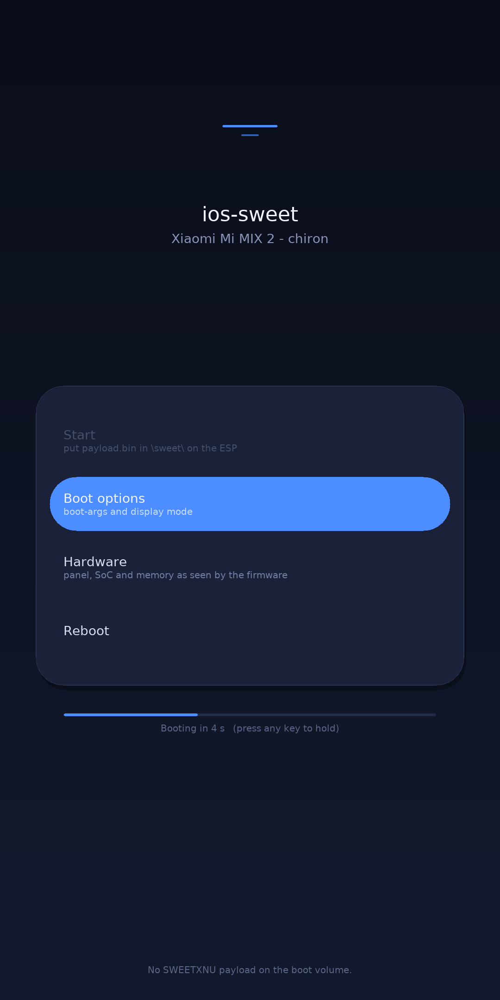

# sweet-uefi

A graphical UEFI boot menu for the [ios-sweet](https://github.com/dipa-studio/ios-sweet)
XNU port on ARM64 phones, targeting the Xiaomi Mi MIX 2 (`chiron`, MSM8998) first.



## What it is

A single freestanding EFI application. It takes the framebuffer over GOP, draws a
menu with an antialiased software renderer, and is meant to be the thing that
decides what boots. Drop it on the ESP as `\EFI\BOOT\BOOTAA64.EFI` and the phone's
normal boot picks it up -- no custom fastboot image involved.

No edk2, no gnu-efi. `clang` emits an `aarch64-pc-win32-coff` object and
`lld-link` produces a PE32+ EFI application, so the whole toolchain is two
binaries any distro ships.

## Build

```sh
./build.sh                     # -> out/sweet-uefi.efi
TTF=/path/to/font.ttf ./build.sh
CLANG=clang-18 LLDLINK=lld-link-18 ./build.sh
```

Needs `clang`, `lld-link`, and `python3-pil` (Pillow rasterises the font atlas).
The generated `src/font.c` is ~490 KB and is rebuilt only when the baker or the
typeface changes.

## Verify it

```sh
./test.sh
```

Three gates: the EFI image builds and really is PE32+ AArch64 **(1)**; the menu
renders and its text fits inside the highlight pill **(2)**; and `include/efi.h`
matches the UEFI specification's field offsets **(3)**.

Gate 3 exists because `efi.h` is transcribed by hand from the spec instead of
vendored from edk2. One missing Boot Services entry shifts every pointer after
it, and the failure at runtime is arbitrary rather than a clean error. The check
compiles a probe, reads `offsetof()` for each field this application calls, and
compares against the values chapter 4.4 implies -- `EFI_BOOT_SERVICES` must be
exactly 368 bytes (24-byte header + 43 function pointers). The first version of
that check had three wrong expectations (`ConOut`, the total size, and the
ordering of `Stall` vs `ExitBootServices`); the header turned out to be correct
and the test was fixed.

## Look at it without a phone

```sh
tools/preview.py --out preview.png --width 1080 --height 2160
tools/check_layout.py preview.png
```

`preview.py` compiles the **same** `gfx.c`/`ui.c`/`font.c` for the host against a
small shim and renders one frame to a PNG. `check_layout.py` then measures the
accent pill and the text inside it and fails if the text does not fit.

Both exist because compiling an EFI binary proves nothing about whether it looks
right. The first render from this tool showed every space in the UI missing --
the words came out as `Bootoptions` and `XiaomiMiMIX2-chiron` -- and a second
pass caught the selected row's second line hanging outside its highlight. Neither
would have been visible any other way short of flashing a phone.

## How it hands over

It does not. This launcher finds the payload, validates the `SWEETXNU` header,
and then says plainly what it found; the segment copy and the MMU transition stay
in the ios-sweet shim (`shim/loader.c`), which already does that job and has been
reviewed. A menu that claims to boot and then silently returns to the firmware
would be worse than one that names the file it could not find.

Payload search order on the volume this image was loaded from:

```
\sweet\payload.bin
\sweet\xnu-payload.bin
\payload.bin
```

## Layout

```
include/efi.h        the UEFI subset used, transcribed from the spec
src/gfx.{c,h}        software renderer: fill, gradient, rounded rect, AA text
src/ui.{c,h}         the menu: layout, animation, countdown
src/payload.{c,h}    payload discovery and validation
src/main.c           GOP setup, input loop, frame pacing
src/font.{c,h}       generated antialiased glyph atlases
tools/bake_font.py   TTF -> alpha atlases (+ per-glyph rects)
tools/preview.py     host render for layout review
tools/check_layout.py  asserts the text fits its pill
tools/check_efi_layout.py  asserts efi.h matches the specification's offsets
test.sh              all three gates
```

## Notes on the UEFI declarations

`include/efi.h` is written from the UEFI 2.10 specification rather than copied
from edk2, so it stays small and the structures match the spec field for field.
Boot Services in particular is transcribed in full order, because one missing
entry silently shifts every pointer after it. `EFI_FILE_PROTOCOL.GetInfo` takes
four arguments (`This, InformationType, BufferSize, Buffer`); getting that wrong
is a compile error here, but the same class of mistake in a hand-written struct
would be a crash on hardware.

## Status

- Builds to a 193 KB PE32+ AArch64 EFI application; `./test.sh` passes.
- The renderer, menu, input loop and payload discovery are exercised by the host
  preview; the EFI binary itself has **not** been booted on a phone yet.
- The `Boot options` / `Hardware` / `Reboot` panels are placeholders and say so
  when selected.
- Payload handoff is deliberately not implemented here; see above.

## Licence

MIT.
